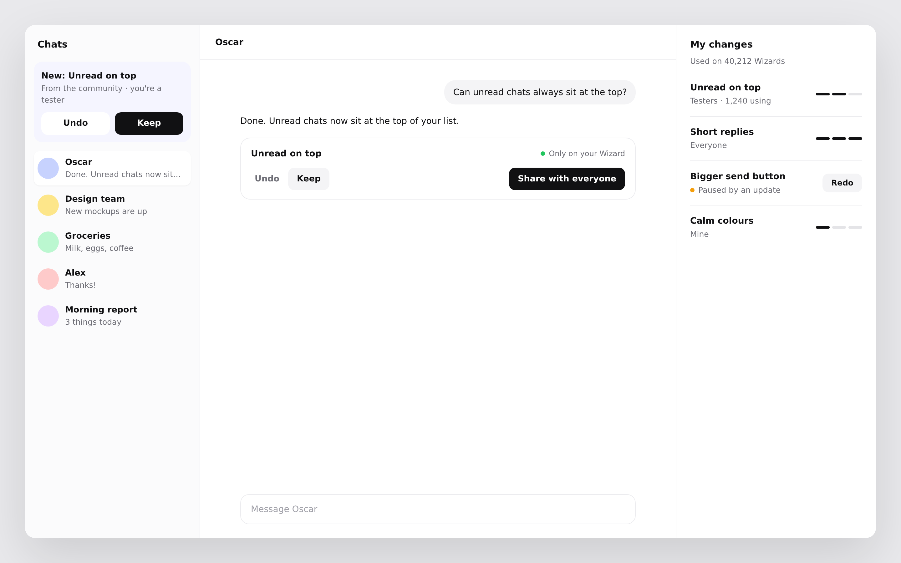
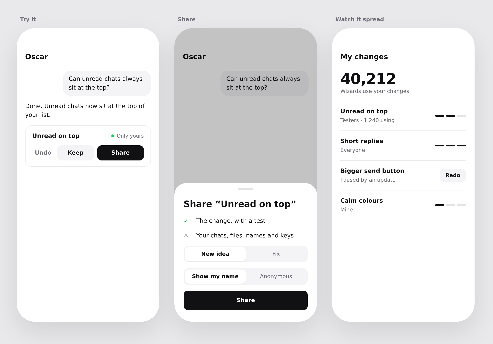

# My Changes

**Status: proposal (Miguel, 29 Oct 2026). Needs James's decision.** Builds on tweaks and the Standard / Early access names ([wizard-ux #673](https://github.com/humanitylabs-org/wizard-ux/pull/673)), the release channels and fast track ([releases/README.md](../releases/README.md), DECISIONS #82), and owner app-update protection (#311).

## My Changes, a system app

**My Changes** is the system app that holds all of this. It replaces the "My Tweaks" naming from wizard-ux #673 (tweaks stay the mechanism underneath). It lists every change a person has kept, where each one sits (Mine, Testers or Everyone), and what needs attention, such as a change paused by an update. The chat card and the share sheet open from the agent's reply; My Changes is where the person goes back to them.

Scope: front-end changes first (looks, layouts, parts of screens, the things tweaks can replace). Back-end changes keep the normal PR route until the front-end flow is proven.

## One flow for the team and for everyone

The team uses exactly the same flow as the public. The only difference is a **maintainer** permission, which today is Miguel, James and Jan. Maintainers also see the list of shared ideas, decide on changes in the areas that always need a maintainer (see point 6 below), and can move a change forward or back by hand. This is a normal open-source project flow with git hidden behind three buttons: a share is a pull request, Testers is Early access, Everyone is Standard, and maintainers are the people who can merge.

## Goal

Anyone, including millions of people who will never open GitHub, can improve Wizard by asking their agent for a change. The good changes reach everyone, and nobody has to learn git, review queues or release channels.

## What the person sees

The whole system shows three words and three buttons.

| Word | Means | Git underneath |
|---|---|---|
| **Mine** | only on my Wizard | my personal layer (a branch) |
| **Testers** | people who opted in to try new things | Early access (`latest`) |
| **Everyone** | every Wizard | Standard (`stable`) |

After any change the agent makes, the chat shows **Undo**, **Keep** and **Share with everyone**. Undo reverts it. Keep keeps it on the person's personal layer, where updates never overwrite it: if an update clashes with it, the layer pauses and the agent offers to redo it. Share hands the change to the sharing pipeline below. After that, the person only sees where the change is (Mine, Testers or Everyone) and how many people use it.

## The five moments

1. **Try it.** The agent makes the change, and the chat shows Undo, Keep and Share with everyone. It is only on this Wizard.
2. **Check what's shared.** Share opens a sheet showing what leaves the Wizard (the change and its test) and what never does (chats, names, files, keys, skin, personal tweaks). The person confirms whether it's a new idea or a fix, and whether to show their name or share anonymously.
3. **A tester sees it.** Testers get a small card where the change appears: "New from the community," with Undo and Keep. Their taps are the signal the rollout runs on.
4. **Watch it spread.** "My changes" shows where each shared change sits (Mine, Testers, Everyone), how many people use it, how many undid it, how many asked for the same thing, and roughly when Everyone gets it. Stop sharing is always available.
5. **Hear back.** People get a notification for each outcome: the change reached everyone; it paused because an update changed that screen (Redo it or Leave it off); or it stepped back, with the testers' reason in plain words (Improve it or Keep mine).

## Why it scales: real use decides, not reviewers

At millions of people, the scarce thing is reviewer time. The design spends it only where it's truly needed.

1. **Most changes stay Mine, and that's fine.** Personal taste never needs anyone's approval. Sharing is optional.
2. **The agent packages every share.** When someone taps Share, their agent writes the PR, removes anything personal (names, data, keys, their skin), labels it as a fix or a feature, and adds a test. A share that can't be packaged cleanly stays Mine, and the agent says why in plain words.
3. **Duplicates merge into one idea.** When many people ask for the same change ("unread on top"), the shares group into one idea, and every copy counts as a vote. Maintainers see a short ranked list, not a flood.
4. **Rollout is gradual and automatic.** A shared change goes to a small group of Testers, then a bigger one, then Everyone. It moves up while people keep it, and it steps back by itself when people tap Undo or errors rise. The rate of Undo taps is the main signal, and it replaces line-by-line review.
5. **Fixes move faster.** A share labelled as a fix with a regression test uses the existing fast track: it can go straight to Everyone once the upgrade test passes (DECISIONS #82). Features wait the usual 72h with Testers.
6. **People decide only at the edges.** Changes that touch privacy, security, money, data formats or other people's data always wait for a maintainer. So do changes that remove features. Everything else is gated by tests, AI review and real use.

## Credit

People get a note when their change moves up ("Your change reached everyone"), plus one number: how many Wizards use their changes. This keeps contributors coming back. Other people can see a contributor's name on a change only if that contributor allows it.

## What exists today

| Piece | Status |
|---|---|
| Personal layer that survives updates | tweaks, wizard-ux #673 (open) |
| Testers / Everyone channels, 72h soak, fix fast track | live (releases/README.md) |
| Protection for owner-modified code during updates | spec, #311 |
| Undo / Keep / Share buttons in chat | new |
| My Changes system app | new (replaces the My Tweaks naming) |
| Maintainer permission (Miguel, James, Jan) | new; today it's GitHub merge rights |
| Agent packaging a share (cleaning out personal data, labelling it, adding a test) | new |
| Grouping duplicate shares into ideas | new |
| Gradual percentage rollout with automatic step-back | new; channels are all-or-nothing today |
| Contributor credit | new |

## Suggested order

1. Undo / Keep / Share buttons, with Share opening a PR exactly as agents do today. This needs no new infrastructure.
2. Show each change's place on Mine / Testers / Everyone, and send the credit note.
3. Agent-side packaging and the list of areas that always need a maintainer.
4. Gradual rollout with automatic step-back, and grouping duplicates into ideas. These are the parts that matter at scale.

## Open questions for James

- What signals can a Wizard send back for rollout (Undo taps, errors) without sharing anything private? This proposal assumes a count only, never content.
- Who can join Testers, and can someone leave it at any time?
- Which areas always need a maintainer (starting list in point 6)?
