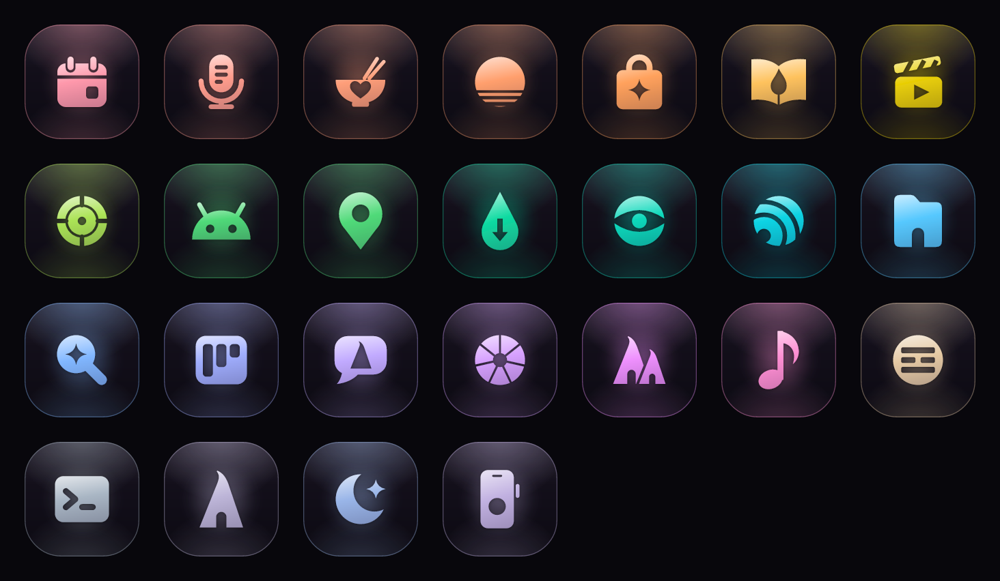

# App icons: sigils

**Owner: James. Status: locked (10 Oct 2026, DECISIONS #33).** Every Wizard app ships with a sigil icon that follows this guide, and every new app is reviewed against it.



A sigil is **one silhouette, one bite, one colour**: a solid shape that says what the app is, with a second meaning cut out of it as negative space. It sits on dark glass tinted by the app's own colour. A launcher full of sigils should look like one family, with every member clearly a different app.

## The rule

1. **Name the noun.** Say in one word what the app holds or does: bag, book, folder, eye, mic. That word becomes the silhouette.
2. **One silhouette.** A single solid filled shape with no outlines, strokes, gradients or detail lines. The silhouette is drawn on a 512 grid, and the generator sizes it by optical area, so a disc and a tall mic carry the same visual weight.
3. **One bite.** Cut the app's second meaning out of the shape as negative space: the spark in Shopping's bag ("the agent does the finding"), the flame in Wisdom's book, the Wizard door in Files' folder, the hat in Chats' bubble. Use exactly one bite. A bite joined to an edge reads better than one floating in the middle.
4. **Borrow the hat where it fits.** The Wizard hat or its door is the family signature, so use it as the bite when it carries the meaning (Chats, Files, Social, the legacy Wizard). Leave it out when it doesn't.
5. **One colour per app.** Every app owns one hue, and every hue sits at the same perceived lightness (OKLCH L≈0.79, C≈0.18), so no tile shouts over another. New hues go in the gaps of the registry, at least 12° from every other vivid app. System, tool and legacy apps are *quiet*: they keep a hue at low chroma (≈0.06).
6. **Dark glass tile.** The tile is always dark, and the glyph carries the colour. The tile is a squircle (radius ≈ 32% of the size), dark violet-black glass, tinted by the app's hue from the top and bottom edges. It has a soft bloom of the hue behind the glyph, a faint white sheen across the top third, a hairline border in the hue, and the glyph lit top-to-bottom (light → app colour → slightly deeper). The glyph fills about 70% of the tile.
7. **No emoji, letters or pictures.** Every icon is a sigil. An app that doesn't have its sigil yet shows its initial on its own colour as a placeholder, never as the shipped icon.
8. **Prove it small.** The sigil must read at 20px (title bars) and 24px (palette rows). If the bite disappears at 24px, make the bite simpler. Extra detail won't fix it.

## Making the icon for a new app

Everything lives in [`style/sigils/`](sigils/). The glyphs are boolean path operations (`skia-pathops`) compiled to a single path each, so they stay crisp at every size.

```bash
cd style/sigils
python3 -m venv .venv && .venv/bin/pip install skia-pathops fonttools resvg-py
.venv/bin/python make_icon.py --list          # the existing glyphs and what each one means
.venv/bin/python make_icon.py --free-hues     # where the new app's colour should go
```

1. **Pick or draw the glyph.** Reuse an existing glyph only when it means the same thing. Otherwise add a function to `glyphs.py`:

   ```python
   @glyph('bag', 'A bag with a spark punched through: the agent does the finding.')
   def g_bag():
       handle = stroke("M196 196 V170 A60 60 0 0 1 316 170 V196", 34)
       body = rrect(124, 184, 264, 228, 36)
       return D(U(handle, body), spark(256, 300, 66, 0.12))   # silhouette minus the bite
   ```

   Primitives: `circle`, `rrect`, `poly`, `stroke` (path → filled outline), `spark`, `hat_at`; operations: `U` union, `D` difference, `I` intersection, `T` scale/move, `R` rotate. The description is the sentence that explains the bite, and it is required.
2. **Claim a hue.** Add the app to `REGISTRY` in `palette.py`: `'my-app': ('glyph', hue, None)` (or a chroma ≈0.06 for a quiet system/tool app). Take the widest band from `--free-hues`.
3. **Export the icon files into the app repo:**

   ```bash
   .venv/bin/python make_icon.py my-app --out ../../../my-app
   ```

   This writes `icon.svg` (the master), `icon.png` (512, the file `wizard.md`'s `icon:` field points to), `icon-192.png` and `icon-maskable.png` (for the PWA manifest; the maskable one keeps the glyph inside the 80% safe zone), plus `favicon.svg` and `favicon-32.png` (the bare glyph in the app colour). It prints the `launcher.json` fields (`icon`, `colors`) for a launcher link.
4. **Wire it in.** Set `icon: icon.png` in `wizard.md`. Point the app's web manifest at `icon-192.png` and `icon-maskable.png` (`"purpose": "maskable"`) and its `<link rel="icon">` at `favicon.svg`. In `wizard-ux`, add the same glyph and registry row to `tools/sigils/` and run `tools/sigils/build.py`, so the launcher draws the live sigil. Its registry must match `palette.py` here.
5. **Check it.** Look at the 512px icon and the 24px favicon side by side. At 24px you should still be able to say what the bite is. Then open the launcher and make sure the new colour doesn't sit next to a near-twin.

## The house set

| App | Glyph | The bite | Colour |
|---|---|---|---|
| `calendar` | `calendar` | A calendar page with today punched out. | `#FE98AB` (8°) |
| `mizel` | `mic` | A microphone whose capsule is cut with three lines: record, transcribe, outline. | `#FE9C8C` (30°) |
| `usuals` | `usuals` | A bowl and chopsticks with a heart cut in: your regular order. | `#FE9E79` (42°) |
| `v-day` | `day` | A sun setting through the horizon: what we did yesterday. | `#FF9F6D` (48°) |
| `shopping` | `bag` | A bag with a spark punched through: the agent does the finding. | `#FFA15C` (55°) |
| `wisdom` | `wisdom` | An open book with a flame burning at the spine: deep reading. | `#FEC25D` (78°) |
| `cinequeue` | `cine` | A clapperboard with play cut into the slate: your watch queue. | `#E9CF06` (100°) |
| `trackhunt` | `track` | A record in the crosshairs: hunting down the track. | `#ABE355` (128°) |
| `android-apps` | `android` | The Android head with its eyes cut out: your phone’s own apps. | `#50DA79` (150°) |
| `maps` | `pin` | A map pin with its hole: you are here. | `#50DA79` (150°) |
| `v-inbox` | `inbox` | A drop with an arrow cut through: things land here for you. | `#11DBA2` (166°) |
| `topics` | `eye` | A watching eye cut into a sphere: a question about the world that keeps looking. | `#0ED8BB` (178°) |
| `wizard-signal` | `signal` | A disc with signal radiating from one point: your feed, not noise. | `#0AD3E3` (205°) |
| `files` | `files` | A folder with the Wizard door cut into its base: your stuff lives in the Wizard’s house. | `#56C8FE` (232°) |
| `wizard-search` | `search` | A lens with a spark in it: search that answers. | `#81B7FF` (256°) |
| `projects` | `projects` | A board with three lanes hanging from the top, each at a different stage. | `#A0AEFE` (276°) |
| `wizard` | `chats` | A speech bubble with the hat cut out of it: you talking to your Wizard. | `#C1AAFF` (296°) |
| `v-week` | `week` | Seven days cut into one wheel: the week, one level up. | `#D6A0FE` (310°) |
| `social` | `social` | Two wizards, the smaller one cut free of the larger: a network of people. | `#EF90FE` (322°) |
| `wizard-music` | `music` | An eighth note whose flag is the curl of the hat’s hook. | `#FF8FD3` (344°) |
| `iching` | `iching` | A casting coin with its square hole: cast and read. | `#E5C9A3` (75°, quiet) |
| `console` | `console` | A terminal window with its prompt cut out. | `#A9B6C4` (250°, quiet) |
| `legacy-wizard` | `wizard` | The mother mark: the hat, with its door joined to the ground line. | `#BDB5D8` (296°, quiet) |
| `v-month` | `month` | A crescent moon with a star in its bite: the arc of the last four weeks. | `#99B5E8` (262°, quiet) |
| `side-button` | `side` | A phone with the orb cut into it and its side key raised: talk from anywhere. | `#C1B1E1` (300°, quiet) |

## Where the sigil appears

Launcher tiles (58px), search rows (40px), window title bars (18–22px), the desktop palette (24px), the "app is loading" card, the app's own PWA icon and favicon, and the store listing. Inside the app, use the same colour as the accent so the app and its icon read as one place.

## Files

| File | What it is |
|---|---|
| [`sigils/glyphs.py`](sigils/glyphs.py) | The glyph library: one function per glyph, its meaning in the decorator. |
| [`sigils/palette.py`](sigils/palette.py) | The colour model and the registry of which app owns which glyph and hue. |
| [`sigils/make_icon.py`](sigils/make_icon.py) | Exports an app's icon files. |
| [`sigils/preview.png`](sigils/preview.png) | The current house set. |

The live implementation is in `wizard-ux`: `tools/sigils/` (the same glyphs and registry), the generated `web/core/sigils.{js,css}` it builds, and `qa-app-sigils.cjs`.
